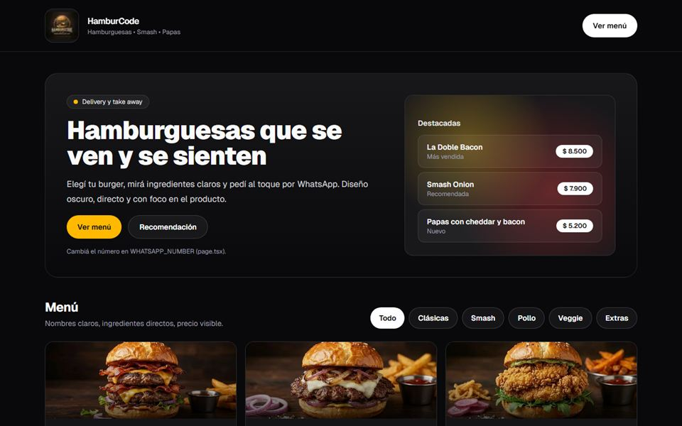
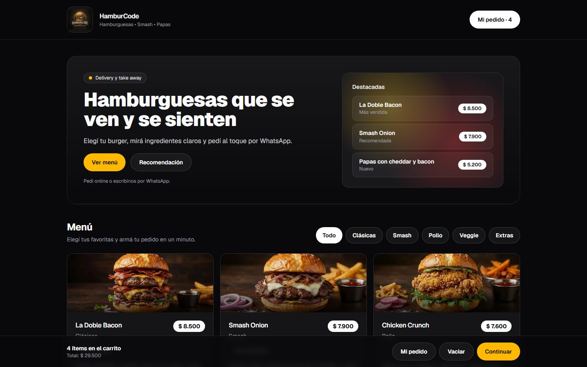
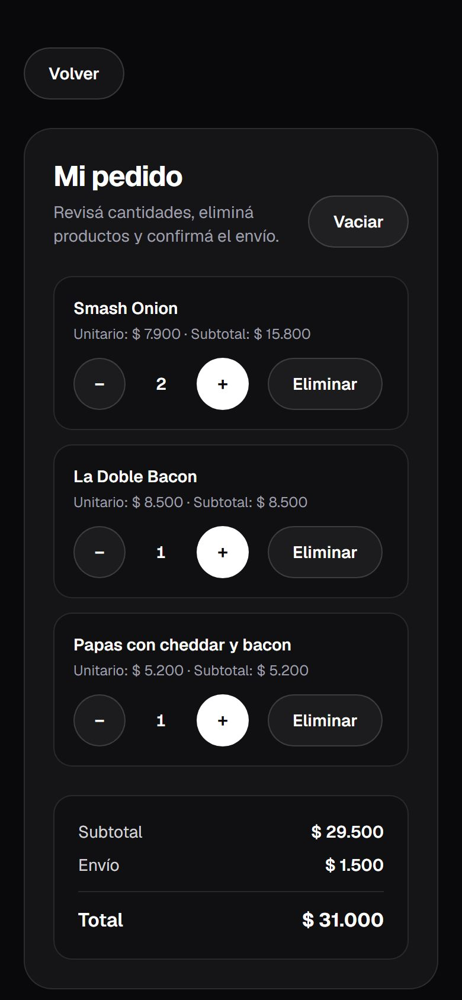
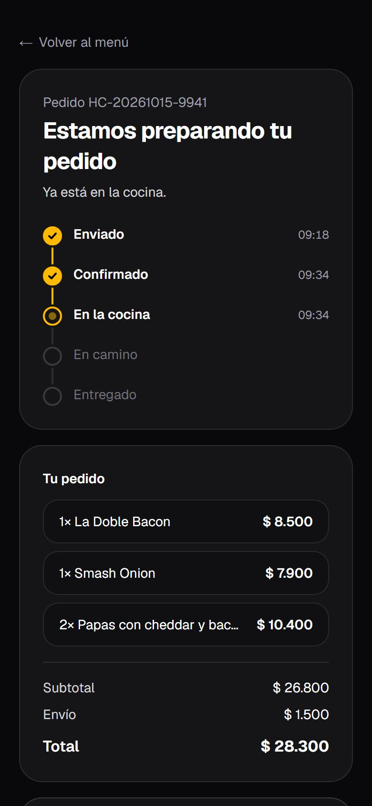
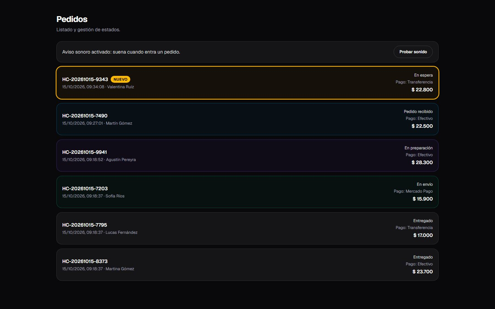
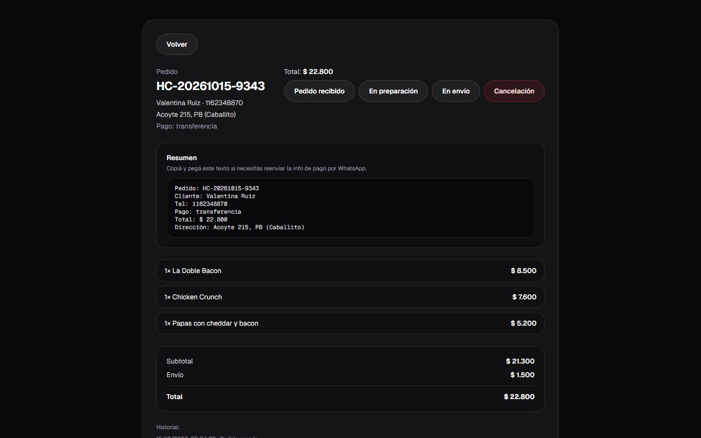
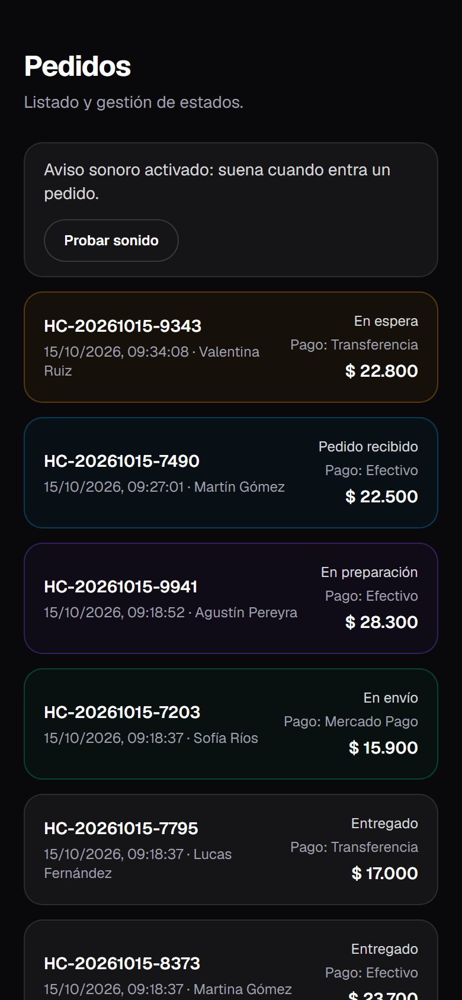

<div align="center">

# HamburCode

**Menú online con pedidos y panel para hamburgueserías: el cliente pide solo y el local gestiona todo, con aviso sonoro cuando entra un pedido.**

[](https://hamburcode.vercel.app)
<br>
     

<br>



</div>

> [!NOTE]
> Proyecto demo con datos de ejemplo de "HamburCode" (negocio ficticio).

## Qué resuelve

Cuando los pedidos llegan por WhatsApp o por teléfono, los mensajes se mezclan, se pierden datos y el cliente pregunta todo el tiempo si su pedido ya está. HamburCode le da al local un menú online ordenado: el cliente elige, carga sus datos y confirma. Cada pedido queda registrado con número propio y el local lo maneja desde un panel, sin depender de chats desordenados.

## Funcionalidades

- **Menú para el cliente**: productos por categoría, con fotos y precios, pensado para el celular.
- **Carrito**: se conserva si el cliente cierra la página.
- **Pedido con datos obligatorios**: nombre, teléfono, dirección y forma de pago (efectivo, transferencia o Mercado Pago). Calcula el envío.
- **Seguimiento**: cada pedido tiene su número y una página donde el cliente ve cómo avanza, con actualización automática.
- **Panel del local con acceso protegido**: lista de pedidos que se actualiza sola, detalle de cada uno y cambio de estado (pendiente, confirmado, en preparación, listo, entregado, entre otros).
- **Aviso sonoro**: el panel suena cuando entra un pedido nuevo.
- **Aviso por WhatsApp**: botón para escribirle al cliente desde el pedido.
- **Opcional**: notificación al sistema del negocio mediante webhook firmado y email de confirmación al cliente (si se configura SMTP).

## Capturas

<table>
  <tr>
    <td align="center" colspan="3"><b>Lo que ve el cliente</b></td>
  </tr>
  <tr>
    <td width="33%"></td>
    <td width="33%"></td>
    <td width="33%"></td>
  </tr>
  <tr>
    <td align="center"><sub>Menú</sub></td>
    <td align="center"><sub>Confirmar el pedido</sub></td>
    <td align="center"><sub>Seguimiento</sub></td>
  </tr>
  <tr>
    <td align="center" colspan="3"><b>Lo que ve el local</b></td>
  </tr>
  <tr>
    <td width="33%"></td>
    <td width="33%"></td>
    <td width="33%"></td>
  </tr>
  <tr>
    <td align="center"><sub>Panel de pedidos</sub></td>
    <td align="center"><sub>Detalle y estado</sub></td>
    <td align="center"><sub>Panel en el celular</sub></td>
  </tr>
</table>

## Tecnologías

| Parte | Tecnología |
| --- | --- |
| Interfaz | Next.js (App Router), React, TypeScript y Tailwind CSS |
| Servidor | Rutas de API de Next.js |
| Base de datos | PostgreSQL con Prisma |
| Emails | Nodemailer (opcional) |
| Publicación | Vercel |

## Para desarrolladores

<details>
<summary><b>Cómo correrlo en tu compu</b></summary>

La aplicación está en la carpeta `hamburcode-web`.

```bash
cd hamburcode-web
npm install
cp .env.example .env.local
npx prisma db push
npm run dev
```

Se abre en `http://localhost:3000`. Hay más detalle en [hamburcode-web/README.md](hamburcode-web/README.md).

</details>

<details>
<summary><b>Variables de entorno</b></summary>

Se completan en `.env.local` (ver `.env.example`) o en Environment Variables de Vercel.

| Variable | Para qué |
| --- | --- |
| `DATABASE_URL`, `DIRECT_URL` | Conexión a la base de datos PostgreSQL |
| `ADMIN_PASSWORD` | Contraseña del panel del local |
| `ADMIN_SESSION_SECRET` | Firma de la sesión del panel |
| `NEXT_PUBLIC_BASE_URL` | Dirección pública del sitio |
| `NEXT_PUBLIC_STORE_WHATSAPP` | WhatsApp del local |
| `STORE_LAT`, `STORE_LNG` | Ubicación del local para calcular el envío (opcional) |
| `BUSINESS_WEBHOOK_URL`, `BUSINESS_WEBHOOK_SECRET` | Aviso firmado al sistema del negocio (opcional) |
| `SMTP_HOST`, `SMTP_PORT`, `SMTP_USER`, `SMTP_PASS`, `SMTP_FROM` | Email de confirmación al cliente (opcional) |

</details>

<details>
<summary><b>Estructura del proyecto</b></summary>

```text
hamburcode-web/
├── prisma/            esquema de la base de datos
└── src/
    ├── app/           páginas: menú, checkout, seguimiento y panel admin
    │   └── api/       pedidos y acciones del panel
    └── lib/           envío, estados de pedido, emails, webhook y sesión
```

</details>

---

<div align="center">

Diseñado y desarrollado por **[laruzo-dev](https://laruzo-dev-ar.vercel.app)**
<br>
<sub>¿Querés un sistema así para tu negocio? <a href="https://laruzo-dev-ar.vercel.app/#contacto">Hablemos</a>.</sub>

</div>
