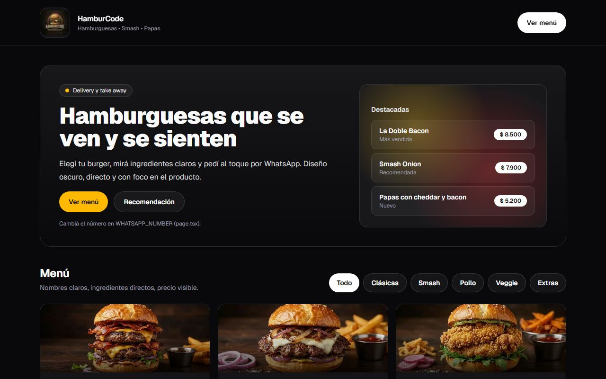

# 🍔 HamburCode

**Menú online con carrito, pedidos y panel de administración para hamburgueserías y locales de comida: tus clientes piden solos y vos gestionás todo desde un solo lugar.**



🔗 [Ver en vivo](https://hamburcode.vercel.app)

## ¿Qué problema resuelve?

Si tomás pedidos por WhatsApp o por teléfono, seguro te pasa que se mezclan los mensajes, se pierden datos o el cliente pregunta "¿ya está mi pedido?". HamburCode le da a tu local un menú online prolijo, donde el cliente elige, carga sus datos y confirma. Cada pedido queda registrado con número propio y vos lo manejás desde un panel, sin depender de chats desordenados.

## Funcionalidades

- Menú con categorías, fotos y precios, pensado para verse bien en el celular.
- Carrito que no se pierde si el cliente cierra la página.
- Checkout con datos obligatorios y cálculo de envío.
- Número de pedido y página de seguimiento para cada orden.
- Panel de administración con login: lista de pedidos, detalle, historial de cambios y actualización de estado.
- Botón para avisar al cliente por WhatsApp desde el panel.
- Opcional: aviso al negocio por webhook y email al cliente (si configurás SMTP).

## Tecnologías

Next.js (App Router), React, TypeScript, Tailwind CSS, Prisma con PostgreSQL y desplegado en Vercel.

## Cómo correrlo localmente

La app está en la carpeta `hamburcode-web`.

```bash
cd hamburcode-web
npm install
cp .env.example .env.local   # completá DATABASE_URL, ADMIN_PASSWORD, etc.
npx prisma db push
npm run dev
```

Se abre en http://localhost:3000. Más detalle de variables y flujo en [hamburcode-web/README.md](hamburcode-web/README.md).

## ¿Querés una web así para tu negocio?

Desarrollo webs y sistemas a medida para comercios y emprendimientos. Escribime o mirá mis otros proyectos en [github.com/DavidSaboredo](https://github.com/DavidSaboredo).
